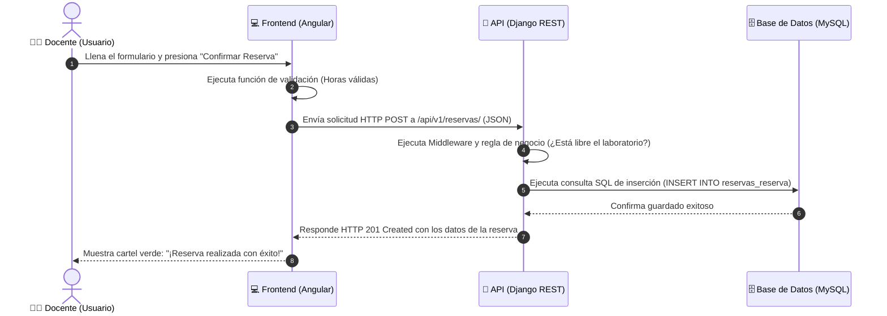

# 🔰 00. Primeros Pasos y Conceptos Clave de Programación

¡Bienvenido/a! Si nunca antes has programado o si esta es la primera vez que ves el código fuente de una aplicación completa, **este es el lugar perfecto para empezar**.

No te preocupes si ves palabras raras o muchos archivos. Programar es simplemente darle instrucciones ordenadas a una computadora para resolver un problema. En este documento aprenderás los conceptos fundamentales explicados de forma muy sencilla, con ejemplos de la vida cotidiana y relacionándolos directamente con nuestro **Sistema de Gestión de Espacios y Reservas**.

---

## 🧩 1. Conceptos Básicos de Programación

### A. Variable
- **¿Qué es con palabras sencillas?** Una **variable** es como una cajita con una etiqueta donde guardamos una información para usarla más tarde.
- **Comparación cotidiana:** Es como un casillero o locker de la escuela. En la puerta pones la etiqueta `Mochila` y adentro guardas tu mochila.
- **En este proyecto:** En la pantalla de registro, guardamos el correo que escribe el docente en una variable llamada `email`.
- **Ejemplo en código:**
  ```typescript
  let emailDocente = "fede@demo.com"; // Guardamos el texto "fede@demo.com" en la variable emailDocente
  ```

---

### B. Función (Function)
- **¿Qué es con palabras sencillas?** Una **función** es una receta de cocina o una secuencia de pasos a seguir para realizar una tarea específica.
- **Comparación cotidiana:** Cuando vas a hacer café, sigues pasos: 1) Calentar agua, 2) Poner café en la taza, 3) Servir el agua. Esos tres pasos juntos forman la función "HacerCafé()".
- **En este proyecto:** Cuando el usuario hace click en el botón "Iniciar Sesión", la computadora ejecuta una función llamada `login()` que verifica el correo y la contraseña.
- **Ejemplo en código:**
  ```python
  def iniciar_sesion(email, password):
      # Pasos para comprobar las credenciales
      return "Sesión iniciada con éxito"
  ```

---

### C. Objeto y Clase
- **¿Qué es una Clase?** Es un plano o molde de construcción (como el plano de una casa). Define qué características tendrá un elemento.
- **¿Qué es un Objeto?** Es la casa real construida a partir de ese plano.
- **Comparación cotidiana:** El molde para hacer galletas en forma de estrella es la **Clase**. Cada galleta horneada que sale del molde es un **Objeto**.
- **En este proyecto:**
  - La **Clase** `Sala` define que todas las salas deben tener un `nombre`, una `capacidad` y un estado `activa`.
  - El **Objeto** real es la sala "Laboratorio Informática A" que tiene capacidad para 35 personas.

---

### D. Frontend (El Cliente / La Pantalla)
- **¿Qué es?** Es todo lo que el usuario ve y toca en su pantalla: los botones, los colores, los formularios, los menús y los textos.
- **Comparación cotidiana:** Es como el salón principal de un restaurante, las mesas, el menú impreso y la atención al cliente.
- **En este proyecto:** El Frontend está programado en **Angular** (HTML, CSS y TypeScript).

---

### E. Backend (El Servidor / La Cocina)
- **¿Qué es?** Es la parte invisible que procesa los datos, revisa la seguridad, realiza cálculos y guarda la información en la base de datos.
- **Comparación cotidiana:** Es la cocina del restaurante. Tú no ves al cocinero preparando la comida, pero allí es donde ocurre el trabajo pesado.
- **En este proyecto:** El Backend está programado en **Python** con **Django REST Framework**.

---

### F. API y Endpoint
- **¿Qué es una API?** API significa *Interfaz de Programación de Aplicaciones*. Es el puente de comunicación entre el Frontend y el Backend.
- **¿Qué es un Endpoint?** Es una dirección de enlace específica (una URL) a la que la pantalla le pide datos al servidor.
- **Comparación cotidiana:** La **API** es el mozo o camarero del restaurante. El **Endpoint** es el plato específico que pides del menú (por ejemplo `/menu/pizzas`).
- **En este proyecto:** Cuando el cliente necesita ver las salas disponibles, le pide información a la API en la dirección `/api/v1/salas/`.

---

### G. Peticiones HTTP (GET, POST, PUT, DELETE)
Son los verbos o acciones que el cliente usa para hablar con el servidor:
- **GET (Obtener):** Pedir datos (ejemplo: "Muéstrame la lista de reservas").
- **POST (Crear):** Enviar datos nuevos (ejemplo: "Crea una nueva reserva para mañana a las 10 AM").
- **PUT / PATCH (Modificar):** Cambiar o actualizar algo existente (ejemplo: "Cambia la capacidad del laboratorio A a 40").
- **DELETE (Eliminar):** Borrar un dato (ejemplo: "Cancela y elimina esta reserva").

---

### H. Base de Datos y Consulta SQL
- **¿Qué es una Base de Datos?** Es un gran archivo digital estructurado en tablas (similares a planillas de Excel conectadas entre sí) donde la información se guarda de forma permanente para que no se pierda al apagar la computadora.
- **¿Qué es una Consulta SQL?** Es una instrucción escrita en el lenguaje SQL para buscar, agregar o cambiar datos en esas tablas.
- **Comparación cotidiana:** Es el archivo central de carpetas de una escuela o biblioteca.
- **En este proyecto:** La base de datos guarda tres tablas principales: `usuarios_usuario`, `salas_sala` y `reservas_reserva`.

---

### I. Middleware
- **¿Qué es?** Es un inspector o filtro de seguridad que revisa cada petición que entra al servidor antes de que llegue a su destino.
- **Comparación cotidiana:** Es como el guardia de seguridad en la entrada de un evento que revisa tu entrada antes de dejarte pasar.
- **En este proyecto:** El middleware revisa permisos como `CORS` para asegurar que solo las solicitudes autorizadas del Frontend puedan comunicarse con el Backend.

---

### J. Promesa / Operación Asíncrona
- **¿Qué es?** En programación, algunas tareas (como pedirle datos a un servidor por internet) toman unos segundos. La computadora hace una "promesa" de avisarte cuando el dato llegue, sin congelar ni trabar la pantalla mientras espera.
- **Comparación cotidiana:** Cuando pides un turno al médico por teléfono, la recepcionista te dice "Espere en línea mientras busco el turno". La pantalla sigue funcionando mientras espera la respuesta.

---

## 🗺️ ¿Cómo encajan todas estas piezas en nuestro proyecto?

Imagina que un profesor entra a la aplicación para reservar un laboratorio de computación:



---

## 🎯 Resumen para el Estudiante

1. **El Usuario** hace click en el **Frontend** (Angular).
2. **El Frontend** emite una **Petición HTTP** a un **Endpoint** de la **API**.
3. **El Backend** (Django) recibe la petición, valida la seguridad con un **Middleware** y revisa las reglas.
4. **El Backend** consulta a la **Base de Datos** con **SQL** o mediante su **ORM**.
5. La **Base de Datos** responde, el **Backend** arma un mensaje en **JSON** y el **Frontend** actualiza la pantalla de forma bonita y dinámica.

¡Ya estás listo/a para explorar el [01. Mapa Completo del Proyecto](01mapacompletodelproyecto.md)!
