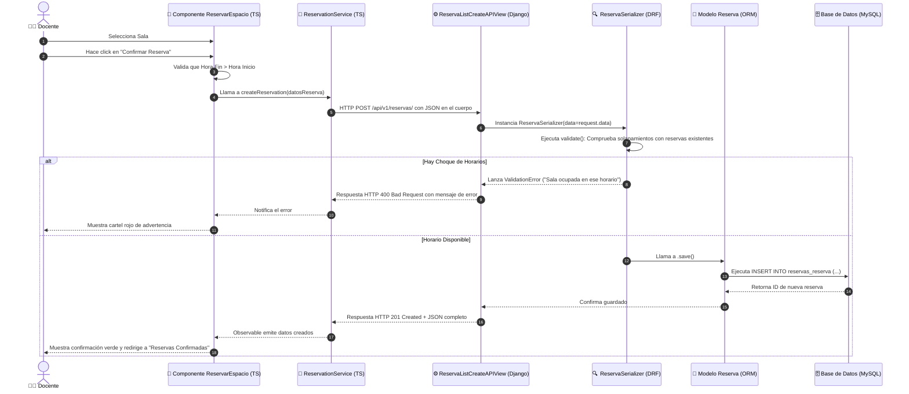

# 🗺️ 01. Mapa Completo del Proyecto y Arquitectura de Software

Este documento ofrece una visión panorámica e integral del **Sistema de Gestión de Espacios y Reservas**. Explica cómo está estructurado el proyecto a alto nivel, cómo se comunican las distintas capas y cómo viaja la información desde la interfaz de usuario hasta la base de datos.

---

## 🏗️ 1. Arquitectura General del Sistema

El proyecto sigue una arquitectura desacoplada de tipo **Cliente-Servidor (RESTful API)**. Esto significa que el cliente visual (Frontend) y el servidor de lógica (Backend) son dos proyectos independientes que conversan exclusivamente mediante peticiones web HTTP con formato **JSON**.

```mermaid
graph TD
    subgraph Cliente_Frontend [💻 FRONTEND - Cliente Web (Angular 18)]
        A[Navegador del Usuario] --> B[Vistas / Páginas HTML+CSS]
        B --> C[Componentes TypeScript]
        C --> D[Servicios HTTP: AuthService, LabsService, ReservationService, UsersService]
    end

    subgraph Red [🌐 RED / INTERNET]
        D <-->|Peticiones HTTP REST / JSON| E[API Gateways / Enrutadores Django]
    end

    subgraph Servidor_Backend [⚙️ BACKEND - Servidor de Aplicación (Django 5 + DRF)]
        E --> F[Middleware: CORS, Security, Auth]
        F --> G[Enrutadores de Apps: usuarios, salas, reservas, reportes]
        G --> H[Vistas APIView / Controladores]
        H --> I[Serializadores DRF: Validación y Conversión JSON]
        I --> J[Modelos Django ORM]
    end

    subgraph Persistencia [🗄️ BASE DE DATOS]
        J <-->|Consultas SQL / Transactions| K[(MySQL / MariaDB / SQLite)]
    end
```

---

## 📁 2. Estructura de Capas del Proyecto

### 📂 A. Capa de Presentación (Frontend)
Ubicada en `frontend/sistema_gestion_espacios/src/app/`:
- **Páginas Públicas (`pages/`):**
  - `landing/`: Portada institucional del sistema.
  - `about/`: Información institucional sobre los laboratorios y el equipo.
  - `login/`: Formulario de inicio de sesión con correo y clave.
  - `register/`: Formulario de alta para nuevos docentes.
  - `recover-password/`: Formulario para restablecer contraseña.
  - `not-found/`: Página de error 404 para rutas inexistentes.
- **Paneles de Control (`pages/`):**
  - `dashboard-admin/`: Panel de gestión para administradores. Contiene submódulos para abm de `salas`, `usuarios`, `reservas` y `reportes`.
  - `dashboard-user/`: Panel para docentes. Contiene submódulos para consultar `espacios`, realizar una solicitud en `reservar`, consultar `confirmadas` e `historial`.
- **Servicios Integrados (`services/`):**
  - `auth.ts`: Maneja autenticación y persistencia de sesión en `localStorage`.
  - `labs.ts`: Gestiona abm de laboratorios.
  - `reservation.ts`: Gestiona reservas y consultas por usuario o sala.
  - `users.ts`: Gestiona administración de usuarios.

---

### ⚙️ B. Capa de Lógica de Negocio (Backend)
Ubicada en `backend/`:
- **`config/`**: Configuración global del servidor Django (`settings.py`), ruteo principal (`urls.py`), despliegue (`wsgi.py`, `asgi.py`).
- **`usuarios/`**: Módulo encargo de cuentas, roles (`admin` / `docente`) y autenticación de login.
- **`salas/`**: Módulo gestor de laboratorios, capacidades y estado activo/inactivo.
- **`reservas/`**: Módulo central de agendamiento. Contiene la regla crítica que impide solapamientos de fecha/hora en un mismo espacio.
- **`reportes/`**: Módulo analítico que procesa la ocupación promedio y estadísticas globales.

---

### 🗄️ C. Capa de Persistencia (Base de Datos)
Definida mediante modelos relacionales y scripts SQL (`backend/init_database.sql`):
- **`usuarios_usuario`**: Registra credenciales, nombres y roles.
- **`salas_sala`**: Registra laboratorios, ciclo formativo, capacidad e imagen.
- **`reservas_reserva`**: Registra el vínculo entre un docente, una sala, horario de inicio y fin, y estado (`confirmada`, `finalizada`, `cancelada`).

---

## 🔄 3. Recorrido Paso a Paso de una Operación Real

A continuación se muestra el camino completo que recorren los datos durante el proceso de **reserva de un laboratorio**:



---

## 📌 Puntos Clave de la Arquitectura

1. **Desacoplamiento:** El Frontend no conoce los detalles internos de la base de datos SQL, solo conoce las respuestas JSON que entrega la API.
2. **Reutilización:** Las mismas APIs creadas en Django podrían alimentar en el futuro una app móvil Android/iOS sin cambiar una sola línea del Backend.
3. **Validación Doble:** Los datos se validan primero en la pantalla (para darle respuesta rápida al usuario) y nuevamente en el servidor (para garantizar la seguridad absoluta e integridad de los datos).
