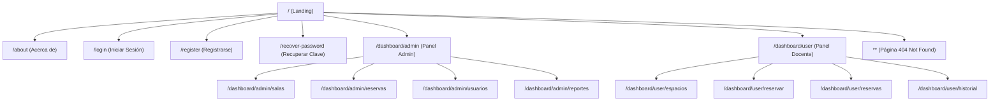

# 🅰️ 04. Frontend Desde Cero: Arquitectura Angular 18

En este documento se explica detalladamente la arquitectura, estructura y decisiones de diseño del cliente visual de la aplicación, desarrollado con **Angular 18**.

---

## 🏛️ 1. Concepto Fundamentales de Angular en este Proyecto

### A. Componentes Standalone (Sin NgModules)
En versiones anteriores de Angular se utilizaban módulos pesados (`NgModules`). En Angular 18, este proyecto utiliza **Componentes Standalone**, lo que significa que cada componente declara directamente sus propias dependencias en su decorador `@Component`. Esto hace que el código sea mucho más modular, liviano y fácil de entender.

---

### B. Inyección de Dependencias Moderna (`inject()`)
En lugar de inyectar servicios en el constructor de la clase (`constructor(private http: HttpClient)`), el proyecto utiliza la función `inject()` de Angular:
```typescript
private http = inject(HttpClient);
```
Esta sintaxis es más limpia, moderna y directa.

---

## 🛣️ 2. Enrutamiento y Navegación (`app.routes.ts`)

La aplicación cuenta con una estructura de rutas jerárquica con **rutas hijas (*child routes*)** para organizar los distintos paneles de control:



---

## 🔌 3. Los Servicios de Datos (Capa de Comunicación)

Los servicios de Angular actúan como el puente que realiza las peticiones HTTP al servidor Django:

1. **`AuthService` (`services/auth.ts`):**
   - Maneja `login()` y `register()`.
   - Mantiene la sesión del usuario guardando su información en `localStorage` con la clave `currentUser`.
   - Proporciona métodos de utilidad como `getCurrentUser()`, `logout()` e `isAuthenticated()`.
2. **`LabsService` (`services/labs.ts`):**
   - Realiza el CRUD de salas llamando a los endpoints `/api/v1/salas/`.
3. **`ReservationService` (`services/reservation.ts`):**
   - Realiza consultas y creación de reservas conectándose a `/api/v1/reservas/`.
   - Permite filtrar reservas por usuario (`?usuarioId=`) o por sala (`?salaId=`).
4. **`UsersService` (`services/users.ts`):**
   - Permite al administrador listar, crear, modificar o desactivar cuentas de usuarios.

---

## 🎨 4. Estilos y Experiencia Visual

- **Barra de Navegación Dinámica (`shared/nav/`):** Detecta automáticamente si el usuario inició sesión y qué rol posee (`admin` o `docente`), cambiando los botones visibles en tiempo real.
- **Pie de Página (`shared/footer/`):** Componente reutilizable presente en las vistas públicas.
- **Formularios y Validaciones:** Los formularios de inicio de sesión, registro y reserva capturan los eventos del usuario, aplican estilos de Bootstrap y muestran mensajes de alerta (éxito/error) según la respuesta emitida por el Backend.
