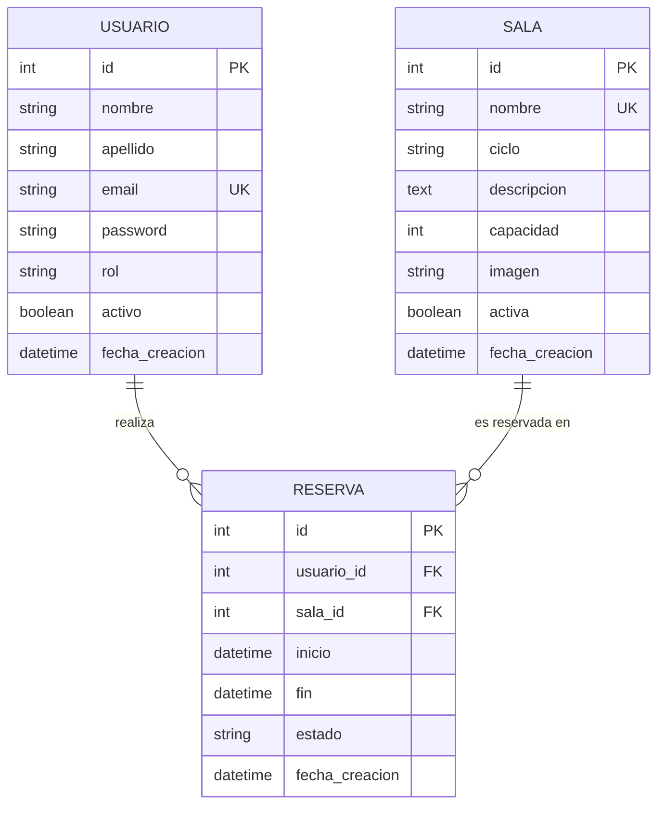

# 🗄️ 07. Base de Datos y Persistencia de Datos

En este documento se analiza la estructura de persistencia relacional del **Sistema de Gestión de Espacios y Reservas**. Se desglosa el modelo Entidad-Relación (DER), las tablas de la base de datos SQL, las restricciones de integridad y cómo se mapean con los modelos ORM de Django.

---

## 📐 1. Modelo Entidad-Relación (DER)

La base de datos está compuesta por tres entidades principales conectadas mediante relaciones relacionales de **uno a muchos (1:N)**:

---

## 📊 2. Especificación de las Tablas SQL

### A. Tabla `usuarios_usuario`
Guarda el registro de usuarios que pueden ingresar al sistema (administradores y docentes).

| Campo | Tipo de Dato | Clave / Restricción | Descripción |
| :--- | :--- | :--- | :--- |
| `id` | `INT AUTO_INCREMENT` | `PRIMARY KEY` | Identificador único numérico |
| `nombre` | `VARCHAR(100)` | `NOT NULL` | Nombre del usuario (min. 2 letras) |
| `apellido` | `VARCHAR(100)` | `NOT NULL` | Apellido del usuario (min. 2 letras) |
| `email` | `VARCHAR(150)` | `NOT NULL UNIQUE` | Correo electrónico institucional |
| `password` | `VARCHAR(255)` | `NOT NULL` | Contraseña cifrada o de acceso |
| `rol` | `VARCHAR(20)` | `DEFAULT 'docente'` | Rol en el sistema: `'admin'` o `'docente'` |
| `activo` | `BOOLEAN` | `DEFAULT TRUE` | Estado de la cuenta (activa / inactiva) |
| `fecha_creacion`| `DATETIME` | `DEFAULT CURRENT_TIMESTAMP` | Fecha y hora del registro |

---

### B. Tabla `salas_sala`
Guarda el catálogo de espacios físicos y laboratorios de computación.

| Campo | Tipo de Dato | Clave / Restricción | Descripción |
| :--- | :--- | :--- | :--- |
| `id` | `INT AUTO_INCREMENT` | `PRIMARY KEY` | Identificador único de la sala |
| `nombre` | `VARCHAR(100)` | `NOT NULL UNIQUE` | Nombre descriptivo del laboratorio |
| `ciclo` | `VARCHAR(100)` | `DEFAULT 'Ciclo Básico'` | Ciclo educativo o ubicación |
| `descripcion` | `TEXT` | `NULL` | Detalle del equipamiento disponible |
| `capacidad` | `INT` | `CHECK (capacidad > 0)` | Cantidad máxima de estudiantes |
| `imagen` | `VARCHAR(255)` | `NULL` | Enlace a foto o render visual |
| `activa` | `BOOLEAN` | `DEFAULT TRUE` | Disponibilidad del espacio |
| `fecha_creacion`| `DATETIME` | `DEFAULT CURRENT_TIMESTAMP` | Fecha de creación del registro |

---

### C. Tabla `reservas_reserva`
Guarda el agendamiento de un laboratorio por un docente en una franja horaria determinada.

| Campo | Tipo de Dato | Clave / Restricción | Descripción |
| :--- | :--- | :--- | :--- |
| `id` | `INT AUTO_INCREMENT` | `PRIMARY KEY` | Identificador único de reserva |
| `usuario_id` | `INT` | `FOREIGN KEY -> usuarios_usuario(id)` | ID del docente reservante |
| `sala_id` | `INT` | `FOREIGN KEY -> salas_sala(id)` | ID de la sala reservada |
| `inicio` | `DATETIME` | `NOT NULL` | Estampa de tiempo de inicio |
| `fin` | `DATETIME` | `NOT NULL` | Estampa de tiempo de finalización |
| `estado` | `VARCHAR(20)` | `DEFAULT 'confirmada'` | Estado: `'confirmada'`, `'finalizada'`, `'cancelada'` |
| `fecha_creacion`| `DATETIME` | `DEFAULT CURRENT_TIMESTAMP` | Momento en que se registró la reserva |

---

## 🔒 3. Restricciones e Índices para Rendimiento

1. **Borrado en Cascada (`ON DELETE CASCADE`):** Si un usuario o sala es eliminado de la base de datos, todas las reservas vinculadas a esa entidad se eliminan automáticamente para evitar "registros huérfanos".
2. **Restricción de Fechas (`chk_reserva_fechas`):** Garantiza a nivel SQL que la fecha/hora de `fin` sea estrictamente mayor que la fecha/hora de `inicio`.
3. **Índices de Optimización:**
   - `idx_usuarios_email`: Agiliza la búsqueda durante el inicio de sesión.
   - `idx_reservas_fechas`: Agiliza las consultas que verifican solapamientos de horario en rangos de fecha.
