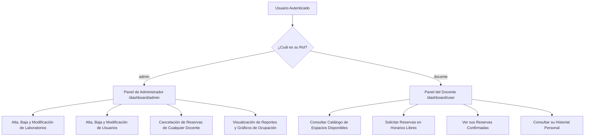

# 🛡️ 09. Seguridad, Permisos y Validaciones de Datos

En este documento se detallan las medidas de seguridad, las políticas de roles de usuario y las reglas de validación implementadas para garantizar el uso correcto del sistema.

---

## 👥 1. Sistema de Roles de Usuario

La aplicación distingue dos roles de usuario bien definidos:

---

## 🔑 2. Mantenimiento de Sesión en el Navegador

Cuando un usuario inicia sesión en la pantalla `/login`:
1. El Backend procesa las credenciales y devuelve el objeto del usuario sin revelar contraseñas.
2. El servicio `AuthService` guarda los datos en el almacenamiento local del navegador (`localStorage`) bajo la clave `'currentUser'`.
3. La barra de navegación (`NavComponent`) detecta este evento y muestra u oculta las opciones del menú según el rol guardado.
4. Al hacer click en "Cerrar Sesión", `AuthService.logout()` elimina la clave de `localStorage` y redirige al usuario a la portada pública.

---

## 🔍 3. Validaciones de Datos (Integridad y Formato)

### A. Validación de Nombres y Apellidos
Tanto en la base de datos como en los formularios, se aplica la función `validate_nombre_apellido`:
- Requiere un mínimo de 2 caracteres.
- Solo permite letras y espacios mediante la expresión regular: `^[a-zA-ZáéíóúÁÉÍÓÚñÑ\s]+$` (evita números o caracteres especiales deshonestos).

### B. Validación de Correo Electrónico
- Requiere un formato válido de e-mail (`CHECK (email LIKE '%@%')`).
- Aplica restricción de **Unicidad (`unique=True`)**: no permite registrar dos usuarios con el mismo correo electrónico.

### C. Validación de Contraseñas
- Requiere una longitud mínima de 4 caracteres.
- En `UsuarioSerializer`, el campo `password` está marcado como `'write_only': True`, lo que garantiza que las contraseñas **nunca se incluyan en las respuestas JSON** enviadas al navegador.

### D. Protección Contra Reservas Inválidas o Solapadas
- Se rechazan reservas donde la hora de finalización sea menor o igual a la hora de inicio (`inicio >= fin`).
- Se rechazan solicitudes que choquen en día y horario con una reserva activa previa en la misma sala.
