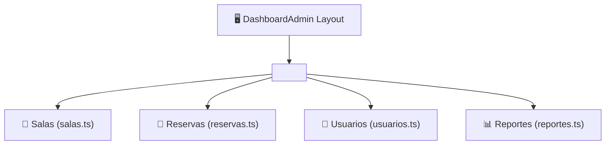

# 📊 Instructivo Técnico: Frontend - Paneles de Control (Dashboards)

Este instructivo analiza la estructura y código de los paneles privados de la aplicación: el **Panel de Administrador** (`dashboard-admin`) y el **Panel del Docente** (`dashboard-user`).

---

## 🛠️ 1. Panel de Administrador (`pages/dashboard-admin/`)

El componente `DashboardAdmin` actúa como un marco contenedor (*Layout*) que incluye una barra lateral de navegación privada y un elemento `<router-outlet>` donde se cargan dinámicamente sus 4 submódulos:

---

### A. Submódulo de Gestión de Salas (`dashboard-admin/salas/`)
- **Funcionamiento (`salas.ts`):**
  - Al iniciar (`ngOnInit`), se suscribe a `labsService.getLabs()` para obtener el catálogo de laboratorios desde la API de Django.
  - Permite abrir un modal para crear una nueva sala enviando el objeto a `labsService.createLab()`.
  - Permite cambiar el estado `activa` de una sala (para pausar o reanudar su disponibilidad) llamando a `labsService.updateLab()`.
  - Permite eliminar una sala llamando a `labsService.deleteLab()`.

---

### B. Submódulo de Gestión de Usuarios (`dashboard-admin/usuarios/`)
- **Funcionamiento (`usuarios.ts`):**
  - Consume `usersService.getUsers()` para mostrar la lista completa de docentes y administradores registrados.
  - Permite crear nuevos usuarios o editar sus roles ('admin' / 'docente').
  - Permite inhabilitar cuentas de docentes desmarcando el interruptor `activo`.

---

### C. Submódulo de Gestión de Reservas (`dashboard-admin/reservas/`)
- **Funcionamiento (`reservas.ts`):**
  - Muestra una tabla global con todas las reservas registradas por todos los docentes de la institución.
  - Permite al administrador cancelar o borrar cualquier reserva conflictiva llamando a `reservationService.deleteReservation()`.

---

### D. Submódulo de Reportes y Estadísticas (`dashboard-admin/reportes/`)
- **Funcionamiento (`reportes.ts`):**
  - Consume la API `/api/v1/reportes/` mediante una petición `HttpClient.get()`.
  - Renderiza 4 tarjetas (*cards*) superiores con las métricas principales:
    1. Total de Reservas Registradas.
    2. Docentes Registrados.
    3. Laboratorios Disponibles.
    4. Ocupación Promedio (en Porcentaje).
  - Muestra barras de progreso visuales de Bootstrap que representan el porcentaje de utilización individual de cada laboratorio.

---

## 👨‍🏫 2. Panel del Docente (`pages/dashboard-user/`)

El componente `DashboardUser` es el entorno de trabajo diario para los profesores.

---

### A. Espacios Disponibles (`dashboard-user/espacios-disponibles/`)
Muestra el catálogo visual de laboratorios activos, detallando la cantidad de computadoras (capacidad), el ciclo educativo y la imagen del espacio. Incluye un botón "Reservar Ahora" que redirige directamente a la pantalla de agendamiento pasando el ID de la sala.

---

### B. Reservar Espacio (`dashboard-user/reservar-espacio/`)
- **Funcionamiento (`reservar-espacio.ts`):**
  - Presenta el formulario de agendamiento con selectores de fecha y hora (`<input type="datetime-local">`).
  - Obtiene automáticamente el ID del docente logueado leyendo `authService.getCurrentUser().id`.
  - Al presionar "Confirmar Reserva", envía los datos a `reservationService.createReservation()`.
  - Si el backend detecta choque de horario, muestra una alerta de error roja. Si se crea con éxito, muestra una alerta verde y redirige a la lista de reservas confirmadas.

---

### C. Reservas Confirmadas e Historial (`reservas-confirmadas/` y `historial-reservas/`)
- **`reservas-confirmadas`:** Consume `reservationService.getReservationsByUser(userId)` y filtra solo aquellas reservas cuyo estado sea `'confirmada'`, permitiendo al docente cancelar sus propios turnos futuros.
- **`historial-reservas`:** Muestra la lista completa de reservas pasadas, finalizadas o canceladas para control personal del docente.
